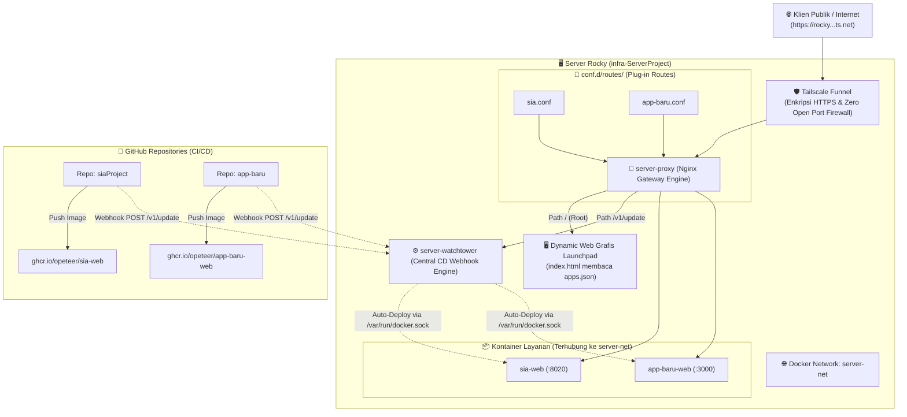

# Rocky Server Modular Infrastructure & Gateway Platform

Infrastruktur runtime terpadu dan modular untuk server **`rocky`**. Dirancang menggunakan arsitektur **Plug & Play** berbasis **Central Reverse Proxy Gateway (`server-proxy`)**, **Central CD Webhook (`server-watchtower`)**, **Shared Docker Network (`server-net`)**, dan **Dynamic Web Grafis Launchpad**.

File inti server bersifat **permanen**; menambahkan atau menghapus proyek web tidak akan pernah menyentuh file inti server.

---

## 🏛️ 1. Arsitektur Sistem

Server `rocky` mengadopsi pola **Enterprise Edge Gateway & Centralized Continuous Deployment (CD)**:



### Karakteristik Utama Arsitektur:
1. **Edge Security**: Tailscale Funnel mengisolasi server dari internet publik. Tidak ada port 80/443 yang dibuka di router fisik/IP publik langsung, melainkan melalui tunnel terenkripsi Tailscale.
2. **Zero-Coupling Gateway**: `server-proxy` (Nginx) memuat rute secara dinamis dari file `conf.d/routes/*.conf`. Kerusakan sintaks pada satu proyek baru tidak akan mempengaruhi proyek lainnya.
3. **Single Central CD**: Hanya ada **1 instance Watchtower** untuk seluruh server yang mendengarkan endpoint `/v1/update`. Tidak ada overhead duplikasi proses CD.
4. **Data-Driven Front Door**: Halaman beranda `/` menyajikan Web Grafis yang merender katalog proyek secara otomatis dari data JSON (`apps.json`).

---

## 🐳 2. Spesifikasi & Standar Teknologi Kontainer

Untuk menjaga efisiensi memori, keamanan, dan portabilitas di server `rocky`, setiap repositori web baru **wajib** mengikuti standar kontainerisasi berikut:

### A. Engine & Format Kontainer
* **Format**: OCI-Compliant Container (*Open Container Initiative*).
* **Runtime**: Docker Engine / Docker Compose.
* **Registry**: **GitHub Container Registry (`ghcr.io`)** – Terintegrasi langsung dengan GitHub Actions dengan hak akses token bawaan (`GITHUB_TOKEN`).

### B. Kebijakan Base Image (*Base Image Policy*)
* **Wajib Menggunakan Base Image Minimalis**:
  * Gunakan varian **Alpine Linux** (misal: `node:20-alpine`, `python:3.12-alpine`, `golang:1.23-alpine`, `eclipse-temurin:21-alpine`) atau **Distroless**.
  * ❌ **Dilarang keras** menggunakan base image OS penuh seperti `ubuntu:latest` atau `debian:latest` untuk runtime aplikasi karena ukurannya yang besar (> 500MB) dan memiliki *attack surface* kerentanan keamanan yang tinggi.
* **Target Ukuran Image Akhir**: Idealnya di bawah **150 MB** (khusus Node/Go/Python) atau di bawah **250 MB** (Java/Spring Boot).

### C. Wajib Menerapkan Multi-Stage Build
Setiap Dockerfile harus memisahkan tahap kompilasi (*builder*) dengan tahap produksi (*runner*):
* **Stage 1 (Builder)**: Mengunduh dependensi lengkap, compilers, SDK, dan mem-build source code.
* **Stage 2 (Runner / Production)**: Hanya menyalin file biner/distribusi yang telah jadi ke runtime yang bersih tanpa *devDependencies* atau compiler tools.

### D. Keamanan Kontainer (*Security Best Practices*)
1. **Non-Root User**: Jalankan aplikasi menggunakan user non-root (misal: `USER node` pada Node.js atau user khusus `appuser`), bukan sebagai `root`.
2. **Environment Port Flexibility**: Aplikasi harus membaca port dari environment variable `PORT` (dengan default fallback).
3. **Stateless Runtime**: Simpan file unggahan (*uploads*) atau data persisten pada database atau Docker Volume terpisah, bukan di dalam layer kontainer lokal.

---

## 📦 3. Apa Saja yang Perlu Dibuat di Dalam Repo Web Baru?

Setiap kali Anda membuat atau mengonfigurasi repositori web baru, pastikan file-file berikut ada di dalam root repo Anda:

```
repo-web-baru/
├── Dockerfile                  # [Wajib] Multi-stage container build
├── .dockerignore               # [Wajib] Mencegah sampah lokal masuk ke image
└── .github/
    └── workflows/
        └── deploy.yml          # [Wajib] Pipeline otomatisasi CI/CD & webhook
```

### 1. File `.dockerignore`
Wajib ada di root repo agar file sementara lokal tidak ikut terkirim ke Docker Daemon:
```text
.git
.github
node_modules
build
dist
.env
.env.local
*.log
.DS_Store
Thumbs.db
```

### 2. File `Dockerfile` (Contoh Multi-Stage Berdasarkan Teknologi)

#### Pilihan A: Node.js / React / Vue / Vite / SPA (Disajikan Nginx Ringan)
```dockerfile
# Stage 1: Build source code
FROM node:20-alpine AS builder
WORKDIR /app
COPY package*.json ./
RUN npm ci
COPY . .
RUN npm run build

# Stage 2: Production web server
FROM nginx:alpine AS runner
COPY --from=builder /app/dist /usr/share/nginx/html
EXPOSE 80
CMD ["nginx", "-g", "daemon off;"]
```

#### Pilihan B: Node.js Backend / Express / NestJS
```dockerfile
FROM node:20-alpine AS builder
WORKDIR /app
COPY package*.json ./
RUN npm ci
COPY . .
RUN npm run build

FROM node:20-alpine AS runner
WORKDIR /app
ENV NODE_ENV=production
COPY package*.json ./
RUN npm ci --omit=dev
COPY --from=builder /app/dist ./dist
USER node
EXPOSE 3000
CMD ["node", "dist/main.js"]
```

#### Pilihan C: Python (FastAPI / Flask)
```dockerfile
FROM python:3.12-alpine AS runner
WORKDIR /app
RUN addgroup -S appgroup && adduser -S appuser -G appgroup
COPY requirements.txt .
RUN pip install --no-cache-dir -r requirements.txt
COPY . .
USER appuser
EXPOSE 8000
CMD ["uvicorn", "main:app", "--host", "0.0.0.0", "--port", "8000"]
```

#### Pilihan D: Go (Golang)
```dockerfile
FROM golang:1.23-alpine AS builder
WORKDIR /app
COPY go.mod go.sum ./
RUN go mod download
COPY . .
RUN CGO_ENABLED=0 GOOS=linux go build -o server .

FROM scratch AS runner
WORKDIR /app
COPY --from=builder /app/server .
EXPOSE 8080
CMD ["/app/server"]
```

### 3. File GitHub Actions Workflow (`.github/workflows/deploy.yml`)
Salin file ini persis ke repositori baru Anda:

```yaml
name: Build, Publish & Deploy

on:
  push:
    branches: [ "main" ]

env:
  REGISTRY: ghcr.io
  IMAGE_NAME: ${{ github.repository }}

jobs:
  build-and-deploy:
    runs-on: ubuntu-latest
    permissions:
      contents: read
      packages: write

    steps:
      - name: Checkout repository
        uses: actions/checkout@v4

      - name: Log in to GitHub Container Registry (GHCR)
        uses: docker/login-action@v3
        with:
          registry: ${{ env.REGISTRY }}
          username: ${{ github.actor }}
          password: ${{ secrets.GITHUB_TOKEN }}

      - name: Extract Docker metadata
        id: meta
        uses: docker/metadata-action@v5
        with:
          images: ${{ env.REGISTRY }}/${{ env.IMAGE_NAME }}
          tags: type=raw,value=latest

      - name: Build and push Docker image
        uses: docker/build-push-action@v5
        with:
          context: .
          push: true
          tags: ${{ steps.meta.outputs.tags }}
          labels: ${{ steps.meta.outputs.labels }}

      - name: Trigger Central Watchtower CD on Server Rocky
        run: |
          echo "🚀 Mengirim webhook deploy ke server rocky..."
          curl -s -X POST \
            -H "Authorization: Bearer ${{ secrets.WATCHTOWER_TOKEN }}" \
            --max-time 15 \
            "${{ secrets.WATCHTOWER_WEBHOOK_URL }}" || true
```

---

## 🛠️ 4. Panduan Langkah Onboarding (*Step-by-Step Onboarding*)

Ikuti checklist 5 langkah berikut untuk memasang repo baru ke server `rocky`:

### Tahap 1: Konfigurasi di GitHub Repository Baru
1. Pastikan file `Dockerfile`, `.dockerignore`, dan `.github/workflows/deploy.yml` sudah di-commit dan di-push ke branch `main`.
2. Masuk ke halaman repo GitHub: `Settings` $\rightarrow$ `Secrets and variables` $\rightarrow$ `Actions` $\rightarrow$ `New repository secret`:
   * **`WATCHTOWER_TOKEN`**: Isi dengan nilai token yang ada di [.env](file:///home/opeteer/infra-ServerProject/.env) server Anda.
   * **`WATCHTOWER_WEBHOOK_URL`**: `https://rocky.<tailnet>.ts.net/v1/update`

---

### Tahap 2: Konfigurasi di Server Rocky (`infra-ServerProject`)

#### Langkah A: Daftarkan Kontainer di [compose.yaml](file:///home/opeteer/infra-ServerProject/compose.yaml)
Buka [compose.yaml](file:///home/opeteer/infra-ServerProject/compose.yaml) dan tambahkan kontainer aplikasi baru di bawah jaringan `server-net`:

```yaml
  nama-proyek:
    image: ghcr.io/username/nama-proyek:latest
    container_name: nama-proyek-web
    restart: unless-stopped
    networks:
      - server-net
    environment:
      - PORT=3000
    labels:
      - "com.centurylinklabs.watchtower.enable=true"  # Wajib untuk Central CD
```
*Jalankan kontainer:*
```bash
docker compose up -d nama-proyek
```

#### Langkah B: Buat File Route Mandiri di `conf.d/routes/`
Buat file baru di `infra-ServerProject/conf.d/routes/<nama-proyek>.conf`:

```nginx
location /nama-proyek/ {
    proxy_pass http://nama-proyek-web:3000/;
    proxy_set_header Host $host;
    proxy_set_header X-Real-IP $remote_addr;
    proxy_set_header X-Forwarded-For $proxy_add_x_forwarded_for;
    proxy_set_header X-Forwarded-Proto $scheme;
    proxy_set_header X-Forwarded-Prefix /nama-proyek;
}
```

#### Langkah C: Daftarkan di Web Grafis ([`gateway-ui/apps.json`](file:///home/opeteer/infra-ServerProject/gateway-ui/apps.json))
Buka [gateway-ui/apps.json](file:///home/opeteer/infra-ServerProject/gateway-ui/apps.json) dan tambahkan 1 entri aplikasi:

```json
{
  "id": "nama-proyek",
  "name": "Nama Proyek Web Anda",
  "path": "/nama-proyek/",
  "icon": "🚀",
  "desc": "Deskripsi singkat layanan baru ini.",
  "tags": ["Node.js", "Tailwind", "PostgreSQL"],
  "status": "Live"
}
```

#### Langkah D: Muat Ulang Gateway (Zero-Downtime)
```bash
./funnel.sh reload
```

**Selesai!** 
* Web langsung muncul di Launchpad beranda `https://rocky...ts.net/`.
* Dapat diakses via URL `https://rocky...ts.net/nama-proyek/`.
* Setiap kali Anda melakukan `git push` di repositori tersebut, GitHub Actions akan otomatis memicu Central Watchtower untuk mengunduh dan me-restart kontainer aplikasi tersebut tanpa mengganggu aplikasi lainnya!

---

## ⚙️ 5. Perintah Manajemen Server ([`funnel.sh`](file:///home/opeteer/infra-ServerProject/funnel.sh))

```bash
# Menjalankan Gateway & Tailscale Funnel
./funnel.sh start

# Memeriksa status dan public URL
./funnel.sh status

# Hot-reload Nginx saat ada rute/app baru tanpa downtime
./funnel.sh reload

# Menghentikan Tailscale Funnel
./funnel.sh stop
```
