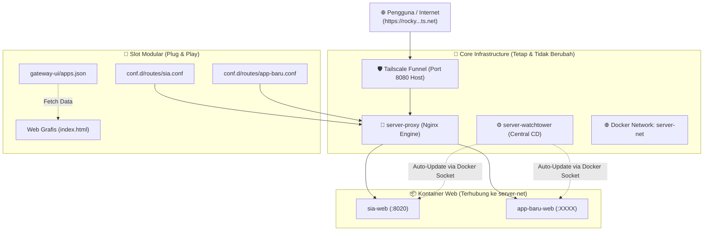

# Rocky Server Modular Infrastructure & Gateway Platform

Infrastruktur terpadu dan modular untuk server **`rocky`**. Dirancang menggunakan arsitektur **Plug & Play** berbasis **Central Reverse Proxy Gateway (`server-proxy`)**, **Central CD Webhook (`server-watchtower`)**, **Shared Docker Network (`server-net`)**, dan **Dynamic Web Grafis Launchpad**.

File inti server bersifat **permanen**; menambahkan atau menghapus proyek web tidak akan pernah menyentuh file inti server.

---

## 🏗️ Topologi Arsitektur Modular



---

## 📁 Struktur Direktori Modular

```
infra-ServerProject/
├── compose.yaml                # Core Gateway + registered services (network: server-net)
├── nginx.conf                  # Core Nginx engine (hanya me-load conf.d/routes/*.conf)
├── conf.d/
│   └── routes/
│       ├── sia.conf            # Route mandiri: Proyek SIA USD
│       └── template.conf.example # Template route untuk proyek baru
├── gateway-ui/
│   ├── index.html              # Dynamic renderer dashboard (HTML/CSS)
│   └── apps.json               # Data katalog aplikasi (Single Source of Truth)
├── funnel.sh                   # Script otomasi & hot-reload gateway
├── tailscale-gateway.service   # Systemd unit file untuk auto-start saat boot
└── README.md                   # Dokumentasi & panduan onboarding
```

---

## 🚀 Panduan Operasional Server

Gunakan skrip manajemen [`funnel.sh`](file:///home/opeteer/infra-ServerProject/funnel.sh):

```bash
# 1. Menjalankan Gateway & seluruh layanan secara otomatis
./funnel.sh start

# 2. Melihat status layanan & URL publik Tailscale
./funnel.sh status

# 3. Hot-Reload rute Nginx baru tanpa downtime (Zero-Downtime)
./funnel.sh reload

# 4. Menghentikan Tailscale Funnel
./funnel.sh stop
```

### Auto-Start Saat Boot (Systemd)
Agar Gateway & Tailscale Funnel otomatis berjalan saat server dinyalakan:
```bash
sudo cp tailscale-gateway.service /etc/systemd/system/
sudo systemctl daemon-reload
sudo systemctl enable --now tailscale-gateway.service
```

---

## 📋 PANDUAN STANDARISASI: Menambahkan Repositori Web Baru

Setiap kali Anda membuat repositori web baru, Anda **tidak perlu mengotak-atik file inti Nginx atau HTML**. Cukup ikuti **5 langkah mudah** berikut (kurang dari 3 menit):

```
[Repo Baru di GitHub] ---> [GitHub Actions Build & Push GHCR] ---> [POST https://rocky.ts.net/v1/update]
                                                                                |
                                                                                v
                                                                    [server-watchtower]
                                                                                |
                                                                                v
                                                                    [Update Kontainer Baru]
```

---

### Langkah 1: Siapkan `Dockerfile` di Repositori Baru Anda
Pastikan proyek baru Anda memiliki `Dockerfile` multi-stage yang mengekspos aplikasi pada port internal (contoh: port 3000, 5000, 8000, atau 8020).

*Contoh sederhana (Node.js/Vite/Next.js/Python/Go):*
```dockerfile
FROM node:20-alpine AS runner
WORKDIR /app
COPY package*.json ./
RUN npm ci --omit=dev
COPY . .
EXPOSE 3000
CMD ["npm", "start"]
```

---

### Langkah 2: Tambahkan GitHub Actions Workflow (`.github/workflows/deploy.yml`)
Salin file workflow berikut ke repositori proyek baru Anda (`.github/workflows/deploy.yml`):

```yaml
name: Build, Publish and Deploy

on:
  push:
    branches: [ "main" ]

env:
  REGISTRY: ghcr.io
  IMAGE_NAME: ${{ github.repository }}

jobs:
  build-and-deploy:
    runs-on: ubuntu-latest
    permissions:
      contents: read
      packages: write

    steps:
      - name: Checkout repository
        uses: actions/checkout@v4

      - name: Log in to GitHub Container Registry
        uses: docker/login-action@v3
        with:
          registry: ${{ env.REGISTRY }}
          username: ${{ github.actor }}
          password: ${{ secrets.GITHUB_TOKEN }}

      - name: Extract Docker metadata
        id: meta
        uses: docker/metadata-action@v5
        with:
          images: ${{ env.REGISTRY }}/${{ env.IMAGE_NAME }}
          tags: type=raw,value=latest

      - name: Build and push Docker image
        uses: docker/build-push-action@v5
        with:
          context: .
          push: true
          tags: ${{ steps.meta.outputs.tags }}
          labels: ${{ steps.meta.outputs.labels }}

      - name: Trigger Central Watchtower CD on Server Rocky
        run: |
          echo "🚀 Mengirim webhook ke Central Watchtower di server rocky..."
          curl -s -X POST \
            -H "Authorization: Bearer ${{ secrets.WATCHTOWER_TOKEN }}" \
            --max-time 15 \
            "${{ secrets.WATCHTOWER_WEBHOOK_URL }}" || true
```

> **Daftarkan 2 Secret di GitHub Repo Baru** (`Settings -> Secrets and variables -> Actions`):
> 1. **`WATCHTOWER_TOKEN`**: Isi dengan nilai token di `.env` server Anda (`WATCHTOWER_TOKEN`).
> 2. **`WATCHTOWER_WEBHOOK_URL`**: `https://rocky.<tailnet>.ts.net/v1/update`

---

### Langkah 3: Daftarkan Kontainer Baru di Server (`compose.yaml`)
Buka `infra-ServerProject/compose.yaml` di server, tambahkan kontainer aplikasi baru di bawah jaringan `server-net`:

```yaml
  nama-proyek:
    image: ghcr.io/opeteer/nama-proyek:latest
    container_name: nama-proyek-web
    restart: unless-stopped
    networks:
      - server-net
    environment:
      - PORT=3000
    labels:
      - "com.centurylinklabs.watchtower.enable=true"  # Wajib agar otomatis di-deploy oleh Central Watchtower
```
*Jalankan kontainer baru:*
```bash
docker compose up -d nama-proyek
```

---

### Langkah 4: Buat File Route Mandiri (`conf.d/routes/nama-proyek.conf`)
Buat satu file konfigurasi kecil di folder `conf.d/routes/` (Anda juga dapat menyalin dari `template.conf.example`):

```nginx
# conf.d/routes/nama-proyek.conf
location /nama-proyek/ {
    proxy_pass http://nama-proyek-web:3000/;
    proxy_set_header Host $host;
    proxy_set_header X-Real-IP $remote_addr;
    proxy_set_header X-Forwarded-For $proxy_add_x_forwarded_for;
    proxy_set_header X-Forwarded-Proto $scheme;
    proxy_set_header X-Forwarded-Prefix /nama-proyek;
}
```

---

### Langkah 5: Daftarkan di Web Grafis (`gateway-ui/apps.json`) & Hot-Reload
1. Tambahkan 1 objek data di [gateway-ui/apps.json](file:///home/opeteer/infra-ServerProject/gateway-ui/apps.json):
   ```json
   {
     "id": "nama-proyek",
     "name": "Nama Proyek Web Baru",
     "path": "/nama-proyek/",
     "icon": "🚀",
     "desc": "Deskripsi singkat fungsi dan tujuan aplikasi ini.",
     "tags": ["Node.js", "React", "PostgreSQL"],
     "status": "Live"
   }
   ```
2. Muat ulang Nginx seketika tanpa *downtime*:
   ```bash
   ./funnel.sh reload
   ```

**Selesai!** Aplikasi baru Anda kini:
- Tampil otomatis di Web Grafis beranda `https://rocky...ts.net/`.
- Dapat diakses langsung melalui link `https://rocky...ts.net/nama-proyek/`.
- Otomatis di-update oleh Central Watchtower setiap kali Anda melakukan `git push` ke repositori tersebut!
